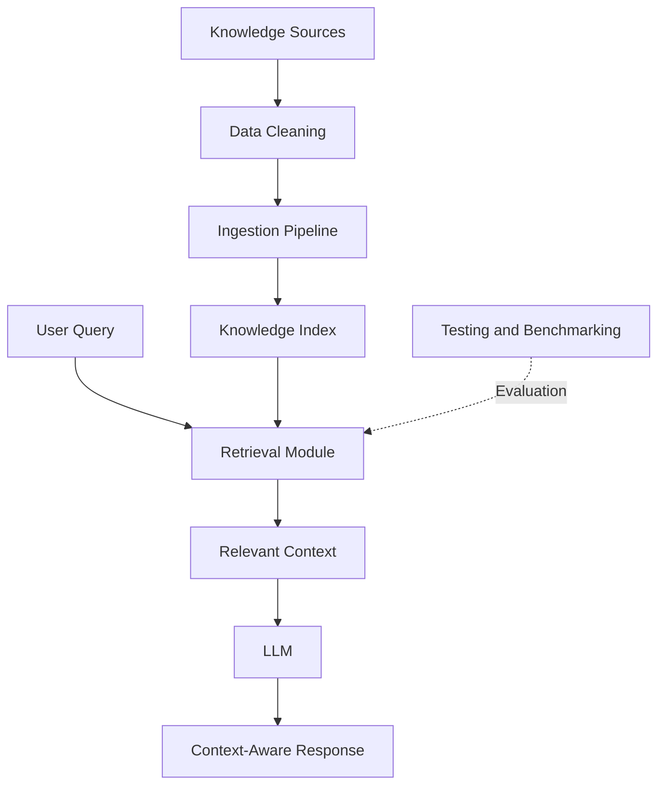

# Enterprise RAG Assistant

**An AI-powered knowledge retrieval application built around Retrieval-Augmented Generation (RAG).**

<p align="center">
  <strong>LLMs · RAG · Hierarchical Retrieval · Python · API Development · Evaluation</strong>
</p>

---

## Overview

**Enterprise RAG Assistant** is an AI engineering project focused on making enterprise knowledge easier to search, retrieve, and use through intelligent information retrieval techniques.

The project explores how Retrieval-Augmented Generation (RAG) can connect Large Language Models (LLMs) with external knowledge sources to support more context-aware responses and reduce reliance on information stored exclusively in model parameters.

Building on my engineering internship experience with **HTH-RAG architecture**, this project showcases my practical interests in retrieval pipelines, hierarchical search, data preparation, API integration, and the evaluation of AI-powered applications.

The repository presents the technical implementation and development approach while excluding confidential business data.

## Objectives

- Explore the design and implementation of a RAG pipeline.
- Prepare and structure data for information retrieval.
- Investigate hierarchical retrieval strategies for enterprise knowledge.
- Develop reusable Python components for ingestion and search.
- Expose application functionality through an API.
- Evaluate retrieval behavior using testing and benchmarking tools.
- Apply software engineering practices to AI application development.

## Key Features

### 1. Data Preparation

Data preparation is an important step in building reliable retrieval systems.

The project includes components for cleaning and preparing information before it enters the retrieval pipeline.

Relevant concerns include:

- Data normalization and cleaning
- Consistent document representation
- Preparation of content for indexing
- Separation of data processing from retrieval logic

### 2. RAG Pipeline

Retrieval-Augmented Generation combines information retrieval with the language-generation capabilities of an LLM.

A typical RAG workflow follows these stages:

1. Ingest the knowledge sources.
2. Clean and prepare the content.
3. Organize the information for retrieval.
4. Retrieve relevant context for a user query.
5. Use the retrieved context to support an LLM response.

The exact implementation depends on the configuration and components used by the project.

### 3. Hierarchical Information Retrieval

The project explores hierarchical retrieval through its HTH-RAG-related components.

Hierarchical retrieval can help organize information at multiple levels, allowing a search system to navigate from broader sections toward more specific content.

Potential benefits include:

- Better organization of enterprise knowledge
- More targeted context retrieval
- Improved navigation through structured information
- A foundation for evaluating different retrieval strategies

### 4. API and Application Integration

The repository includes Python application and API-related modules.

This separation supports the development of AI functionality that can be integrated into an application rather than remaining an isolated experiment.

### 5. Testing and Benchmarking

Evaluation is essential when building retrieval systems.

The project includes testing and benchmarking scripts intended to support experimentation with the retrieval workflow and application behavior.

These components provide a foundation for investigating search quality, consistency, and potential areas for improvement.

## Architecture

The following diagram illustrates the general workflow of a RAG application. It is a conceptual overview, not a claim that every stage is implemented exactly this way in the current repository.



## Technology Stack

| Area | Technologies / Concepts |
|---|---|
| Programming | Python |
| AI | Large Language Models (LLMs) |
| Retrieval | Retrieval-Augmented Generation (RAG) |
| Architecture | HTH-RAG / hierarchical retrieval concepts |
| Backend | API development |
| Quality | Testing and benchmarking |
| Version Control | Git and GitHub |

*The table describes the project's main technical areas. Add specific frameworks, databases, vector stores, and model providers only when they are actually used in the code.*

## Repository Structure

```text
enterprise-rag-assistant/
├── api.py
├── app.py
├── app_ui.py
├── benchmark.py
├── clean_data.py
├── ingest_hth.py
├── search_hth.py
├── test_hierarchy.py
├── test_server.py
├── index.html
├── .gitignore
└── README.md
```

### Main Components

| File | Purpose |
|---|---|
| `api.py` | API-related functionality |
| `app.py` | Main application logic |
| `app_ui.py` | Application interface |
| `benchmark.py` | Benchmarking and evaluation |
| `clean_data.py` | Data cleaning and preparation |
| `ingest_hth.py` | Ingestion workflow |
| `search_hth.py` | Search and retrieval functionality |
| `test_hierarchy.py` | Tests related to hierarchical retrieval |
| `test_server.py` | Server-related tests |
| `index.html` | Web interface or page structure |

*These descriptions are based on filenames and should be checked against the actual source code.*

## Getting Started

### Prerequisites

- Python 3.10 or another version supported by the project's dependencies
- Git
- Access to any required model provider or external service, if applicable

### 1. Clone the Repository

```bash
git clone https://github.com/DriraSalma/enterprise-rag-assistant.git
cd enterprise-rag-assistant
```

### 2. Create a Virtual Environment

**Windows:**

```bash
python -m venv .venv
.venv\Scripts\activate
```

**Linux / macOS:**

```bash
python3 -m venv .venv
source .venv/bin/activate
```

### 3. Install Dependencies

If a `requirements.txt` file is provided:

```bash
pip install -r requirements.txt
```

If the dependencies have not yet been documented, create a `requirements.txt` containing the packages actually imported by the project.

### 4. Configure Environment Variables

If the application requires API keys or other configuration, store them in a local `.env` file and load them through the appropriate configuration mechanism.

Never commit real credentials or confidential configuration.

### 5. Run the Application

The exact startup command depends on the framework and entry point configured in the project. Check the imports and application startup code in `app.py`, `api.py`, and `app_ui.py` before documenting the final command.

## Testing and Evaluation

Testing and benchmarking are important for building robust AI systems.

The repository includes scripts that can be used to investigate the behavior of the retrieval and application components.

Potential evaluation dimensions include:

- Relevance of retrieved information
- Consistency of search results
- Response latency
- Robustness to different queries
- Correctness of application behavior

These are evaluation dimensions to consider, not measured results claimed by this project. Quantitative results should be added only after running documented experiments.

## Engineering Principles

This project reflects several principles relevant to AI application engineering:

- **Modularity:** separating ingestion, search, application, and evaluation components.
- **Reproducibility:** documenting configuration and execution steps.
- **Data privacy:** keeping internal and confidential data out of the public repository.
- **Testability:** maintaining dedicated testing and benchmarking scripts.
- **Maintainability:** organizing the project so components can be understood and improved independently.

## Future Improvements

Possible directions for further development include:

- Comparing alternative retrieval strategies
- Evaluating retrieval quality with a documented benchmark dataset
- Adding retrieval metrics such as Precision@K, Recall@K, and Mean Reciprocal Rank where appropriate
- Investigating hybrid search and reranking
- Improving observability and error handling
- Adding automated tests and continuous integration
- Documenting deployment and performance considerations

These items are potential extensions, not necessarily implemented features.

## Data Privacy and Responsible Development

This public repository is intended to demonstrate technical skills and software architecture.

- Internal company datasets are not included.
- Credentials, tokens, and private configuration must remain excluded.
- Any sample data used for demonstrations should be synthetic or explicitly approved for public release.
- Code developed during an internship should only be published to the extent permitted by the applicable company agreement and authorization.

## About Me

**Salma Drira**  
Software Engineering Student — ISSAT Sousse, Tunisia

I am interested in Software Engineering, Generative AI, Large Language Models, Retrieval-Augmented Generation, and AI-powered applications.

My engineering internship experience includes working on an intelligent chatbot based on HTH-RAG architecture, which strengthened my interest in developing practical AI solutions that connect language models with enterprise knowledge.

### Areas of Interest

- Generative AI and LLM applications
- RAG pipelines and information retrieval
- Hierarchical and agent-based AI architectures
- Python and backend development
- AI evaluation and application integration

### Connect

- **GitHub:** [DriraSalma](https://github.com/DriraSalma)

---

